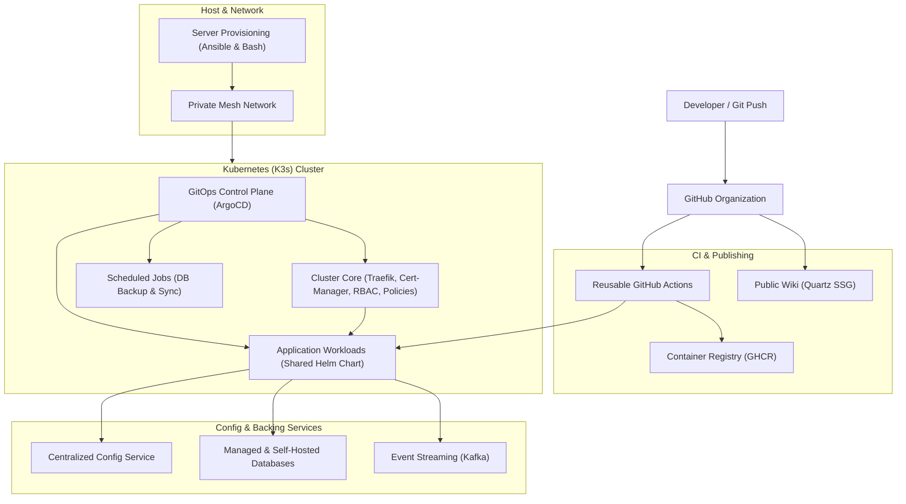

# Architecture Overview (`KAnggara`)

## 1. Component Architecture

## 2. Request, Deployment & Data Flow
1. **Server Provisioning**: Host disiapkan menggunakan otomasi Bash & Ansible (hardening OS, container runtime, dan jaringan mesh VPN privat).
2. **Ingress & TLS**: Trafik publik masuk langsung ke **Traefik Ingress** dengan sertifikat TLS otomatis dari **Cert-Manager** (DNS-01 & Let's Encrypt).
3. **CI Pipeline**: Push ke repositori aplikasi memicu *reusable* [GitHub Composite Actions](https://github.com/KAnggara/DevOps) untuk unit testing, build aplikasi/container, push image ke GHCR, dan deployment Helm.
4. **GitOps Sync**: **ArgoCD** menerapkan pola *App-of-Apps* dengan isolasi `AppProject` (`core`, `data`, `observability`, `apps`) untuk menyinkronkan komponen inti klaster, workload aplikasi, dan *scheduled jobs*.
5. **Backing Services**: Pod aplikasi terhubung ke layanan eksternal (database, broker pesan, cache) melalui abstraksi DNS internal Kubernetes (`ExternalName` Services) serta penyimpanan persisten dalam klaster.

## 3. Scheduling & Resource Governance
- **Namespace Quotas**: Tenant namespace dilengkapi `LimitRange` dan `ResourceQuota` untuk menjaga isolasi sumber daya.
- **Node Placement Policy**: `ValidatingAdmissionPolicy` memastikan beban kerja non-produksi dijadwalkan ke node khusus sesuai label yang ditetapkan.
- **Rolling Upgrades**: Pembaruan versi node K3s dijalankan secara bertahap melalui Rancher System Upgrade Controller.

## 4. Fault Tolerance & Sync Policy
- **ArgoCD Self-Healing**: Sinkronisasi GitOps mengaktifkan `automated.prune`, `automated.selfHeal`, `Validate=true`, dan `PruneLast=true`.
- **Atomic Helm Rollout**: Pipeline deployment mendukung mekanisme rollback atomik pada kegagalan rilis.

## 5. Observability & Telemetry
- **Monitoring & Logging Stack**: Klaster menggunakan **Prometheus** (metrik TSDB), **Grafana** (visualisasi dashboard), **Loki** (aggregasi log), **Tempo** (distributed tracing), dan **Grafana Alloy** (telemetry collector).

## 6. Security & Configuration Boundaries
- **Authentication**: Akses UI control plane dilindungi dengan SSO berbasis OAuth (Dex).
- **Secret Handling**: Kredensial diinjeksikan ke container melalui Kubernetes `secretKeyRef` dan dikelola secara deklaratif menggunakan **Sealed Secrets** (tanpa kredensial plaintext di repositori).
